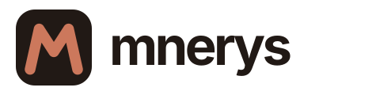
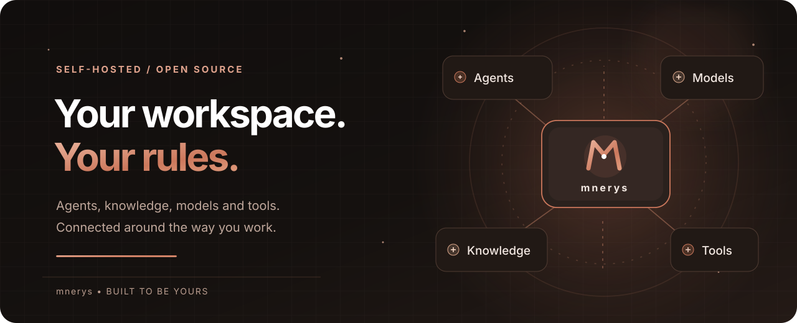

<p align="center">
  <picture>
    <source media="(prefers-color-scheme: dark)" srcset="assets/branding/mnerys-wordmark-dark.svg">
    <source media="(prefers-color-scheme: light)" srcset="assets/branding/mnerys-wordmark-light.svg">
    
  </picture>
</p>

<p align="center">
  <strong>Built to be yours.</strong>
</p>

<p align="center">
  A self-hosted, open-source AI workspace for people who want to shape their own tools, workflows, and AI experience.
</p>

<p align="center">
  <a href="#what-is-mnerys">Overview</a> ·
  <a href="#capabilities">Capabilities</a> ·
  <a href="#quick-start">Quick Start</a> ·
  <a href="#project-status">Project Status</a> ·
  <a href="#license-and-credits">License</a>
</p>

<p align="center">
  
</p>

## What is Mnerys?

**Mnerys** is an independent, self-hosted AI workspace designed around a simple idea: your AI should adapt to you, not the other way around.

The goal is to bring conversations, agents, knowledge, tools, integrations, and everyday workflows into a workspace you can shape to fit your needs. Mnerys is open source, with an emphasis on ownership, extensibility, and control over how your AI works.

> **Early development:** Mnerys has just imported its initial codebase. The interface, configuration, packages, and documentation are still being transitioned from Odysseus. This is a development foundation, **not yet a separately branded, production-ready Mnerys release**.

## Capabilities

The imported foundation already includes:

- **Chat and agents** — conversations, model providers, tool execution, MCP integrations, files, skills, and memory.
- **Research and knowledge** — multi-step research, document editing, notes, uploads, and search.
- **Everyday workspace** — tasks, calendar, email, reminders, and scheduled agent workflows.
- **Model flexibility** — connections to API providers and local model workflows.
- **Creative and utility tools** — image gallery, model comparison, themes, and customizable presets.
- **Self-hosting** — run the workspace on your own infrastructure and decide which integrations to enable.

These are capabilities inherited from the initial codebase. They are being reviewed and will evolve as Mnerys develops its own architecture.

## Quick Start

### Docker Compose (development preview)

**Requirements:** Git and Docker with the Compose plugin. The repository is currently private, so cloning requires access.

```bash
git clone https://github.com/isyuricunha/mnerys.git
cd mnerys
cp .env.example .env
ODYSSEUS_IMAGE=mnerys:local docker compose up -d --build
```

Open **http://localhost:7011** after the containers have started. The initial admin credentials are printed in the application's logs:

```bash
docker compose logs odysseus
```

**Why the legacy names?** The first import still uses the upstream Compose service name `odysseus` and the `ODYSSEUS_IMAGE` variable. Using `mnerys:local` above forces a local build under a Mnerys image tag rather than presenting the upstream project's published image as an official Mnerys release. These implementation details will be renamed during the application rebranding.

The initial Compose stack also includes ChromaDB, SearXNG, and ntfy. Review `docker-compose.yml` and `.env.example` before deployment; external-service options and a more modular setup are part of the planned architecture work.

**Security:** The default Compose web port binds to localhost. Keep authentication enabled, do not publish internal service ports, and use an HTTPS reverse proxy or trusted VPN for remote access. The application currently supports powerful local tools, so only grant permissions you understand.

The existing [setup guide](website/setup.md) describes more installation options, but it still contains upstream-era instructions and names while migration is in progress.

## Project Status

Mnerys is at the **foundation and rebranding** stage.

The immediate priorities are:

1. Establish a consistent Mnerys identity across the repository, interface, and documentation.
2. Validate installation, core functionality, security boundaries, and tests against the imported baseline.
3. Review the agent runtime, memory, integrations, configuration, and permissions.
4. Evolve the codebase into an independent, maintainable, modular platform.

There is no requirement to retain compatibility with future Odysseus releases, and there is no automatic upstream synchronization. The current code is a starting point, not a constraint on Mnerys's direction.

**Screenshots:** New product screenshots will be added after the application UI is rebranded. The illustration above is artwork, not a screenshot of the current application.

## Contributing

Mnerys is in early development and the contributor workflow is being defined. You can follow the project or open an issue in the [GitHub repository](https://github.com/isyuricunha/mnerys) when access is available.

Some imported documentation, including `CONTRIBUTING.md` and `ROADMAP.md`, still describes the former project's workflow and should not be taken as Mnerys policy until updated.

## License and Credits

Mnerys's initial codebase was imported from the [Odysseus](https://github.com/odysseus-dev/odysseus) `main` branch at commit [`9d0d3720`](https://github.com/odysseus-dev/odysseus/commit/9d0d3720f4ca181d87bef94da826d730acc6d483). The original Git history is preserved.

Mnerys is an independent project, not an official Odysseus release. Original authors retain their respective copyrights. See [LICENSE](LICENSE) for the GNU Affero General Public License and [ACKNOWLEDGMENTS.md](ACKNOWLEDGMENTS.md) for additional contributors, dependencies, and license notices.

---

<p align="center"><strong>Mnerys</strong> · Built to be yours.</p>
